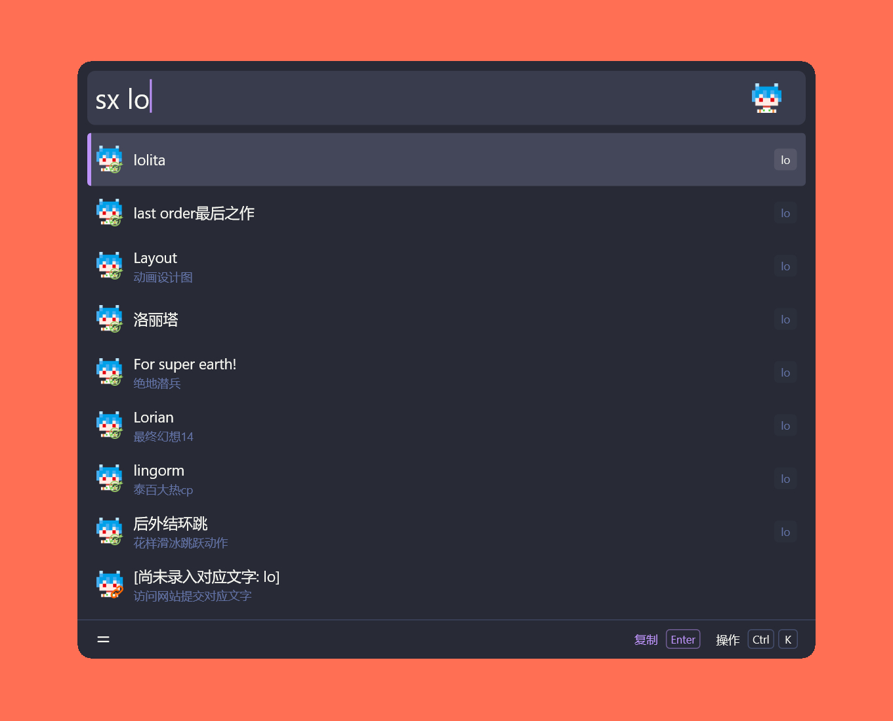

# 「能不能好好说话？」 Wox 插件

这是一个用于 [Wox](https://www.woxlauncher.com/) 的拼音首字母缩写翻译插件，实现通过缩写查询对应的翻译内容。

## 截图预览



## 安装

```shell
wpm install Nbnhhsh
```

## 用法

输入触发关键字（默认为 `sx`）以及缩写内容，例如：`sx lo`，选择条目后则会将结果复制到剪贴板中。

## 设置

在 Wox 设置 → 插件 → Nbnhhsh 中勾选「预览展示全部释义」（默认关闭）：

- 关闭时：不显示预览面板。
- 开启时：结果右侧的预览面板会列出该缩写的全部释义与可能的结果，滚动即可查看完整内容。

## 致谢

- [itorr/nbnhhsh](https://github.com/itorr/nbnhhsh)
